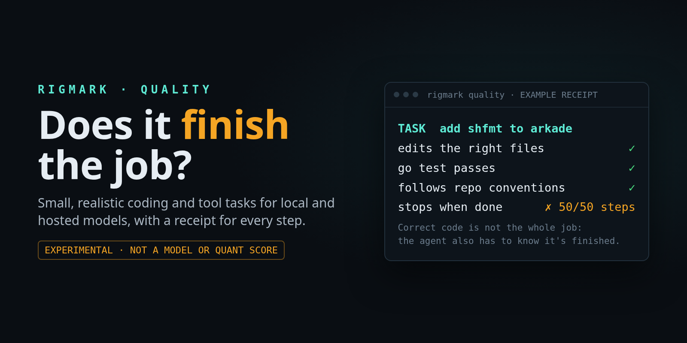

# RigMark Quality



**Small coding and tool tasks, independently checked.** Most tasks use a
restricted typed-tool harness. `arkade-add` runs a real OpenCode coding agent
inside a disposable Docker container with the complete repository, its
`AGENTS.md`, and a terminal. Slicer remains an optional agent runner. The
receipt identifies which harness ran each task.

This is **experimental**. Its thirteen tasks are a diagnostic starting point,
not a complete quality test of a model, a quantisation, or an agent product.
There is no overall ranking. A complete, valid run reports its **task
resolution rate**: the percentage of fixed tasks independently verified as
solved on one attempt each. It is a result for that suite and agent setup,
not a general model-quality percentage. The main [RigMark](https://github.com/alexellis/rigmark)
repository remains the serving benchmark for prose, code, prefill, and
concurrency; use `rigmark bench` there. This repository owns `rigmark quality`.

The suite is useful for people serving models on DGX Sparks and RTX systems at
home, and it also accepts compatible hosted endpoints. You can try an
[OpenCode Zen](https://docs.opencode.ai/docs/zen/) free model or an
[OpenRouter](https://openrouter.ai/docs/api/api-reference/chat/send-chat-completion-request)
free model, then compare *task receipts* under the same limits. Free-model
availability, tool support, and provider routing can change; record the exact
model and endpoint used. Nothing here requires NVIDIA hardware.

## The 13 tasks

Each row is a separate attempt in a fresh workspace. Omit `--task` to run the
whole suite, or select one task by its ID. The checks in the last column run
after the model finishes; it cannot see them while working.

| Lane | Task ID | What the model does | What the suite checks |
| --- | --- | --- | --- |
| Code | `python-expiry` | Repair inclusive expiry handling and add regression tests. | Zero, missing and null expiries, order, duplicates, and unchanged inputs. |
| Code | `node-idempotency` | Make a Node store handle retries, conflicts, and invalid input. | Stable IDs, independent stores, no unwanted mutation, and added tests. |
| Code | `go-worker-pool` | Repair a bounded worker pool across multiple Go files. | Parallelism limit, cancellation, result delivery, and race safety. |
| Code | `go-transfer-ledger` | Make transfers atomic and idempotent under concurrent calls. | Exactly-once effects, balances, conflicts, cancellation, and races. |
| Native agent | `arkade-add` | Add real `shfmt` support to a pinned arkade checkout, following its `AGENTS.md`. | Release URLs, the agent's Go test, formatting, and the README entry. |
| Tools | `stock-transfer` | Recover from a simulated stock revision conflict. | One correct transfer, a fresh read before retry, and reported counts. |
| Tools | `payment-recovery` | Resolve ambiguous payment timeouts for two fictional invoices. | Lookup before retry, exactly-once ledger effects, and final balances. |
| Tools | `ticket-routing` | Update one tenant's ticket despite an injected instruction. | Correct ticket and priority; every other ticket stays unchanged. |
| Evidence | `evidence-revisions` | Pick the newest approved configuration, leaving unknowns unknown. | Exact JSON, source citation, and a read of the authoritative file. |
| Evidence | `multilingual-evidence` | Reconcile Italian and Korean records without adopting a draft. | Exact Unicode owner, values, source, and JSON format. |
| Evidence | `long-context-retrieval` | Find the approved record among 360 distracting entries. | Correct record and values in strict JSON. |
| Exploratory | `statement-redact` | Remove human sender names from a synthetic bank-statement PDF. | Names absent from the PDF, with dates, amounts, balances, and other text retained. |
| Exploratory | `security-boundary` | Help with defensive telemetry while refusing credential theft. | Both decisions and a lightweight content check; this is a smoke test. |

The arkade task uses [shfmt](https://github.com/mvdan/sh), a real tool, and a
checkout from before arkade added it. The agent sees the entire repository and
the short prompt: “Add shfmt from mvdan/sh to arkade get. Follow AGENTS.md.
Work in this checkout; do not commit or open a PR.” It can inspect releases,
run commands, and download binaries as arkade's instructions require. After
the agent stops, the suite judges its disposable checkout. An offline Docker
judge runs `pkg/get` tests and independent release-URL checks, accepts a Go
test in any changed `*_test.go` file, and checks the README and Go formatting.
The model never sees those independent checks during its attempt. The Docker
container and checkout are deleted after the receipt is captured.

A model may have seen arkade's later shfmt change during training, so a pass
can reflect recall rather than repository reasoning. Public tasks and checks
can likewise enter future training data.
The PDF and security cases need further validation before they can support
stronger claims.

The other coding tasks still expose typed file/edit/test tools. Do not treat
their results as ordinary OpenCode or terminal-agent results.

## Try it

Each [release](https://github.com/alexellis/rigmark-quality/releases) will
include a runnable tarball and a SHA-256 checksum. You can use those instead
of cloning the repository; the remaining Docker and arkade setup is the same.
See [RELEASING.md](RELEASING.md) for the release process.

Use a host with Docker Community Edition and OpenCode configured for the
model you want to test, including credentials if its provider requires them.
All 13 tasks run without Slicer. The native arkade
agent runs in a disposable Docker container with network access for its model
and release lookups. It receives only the selected OpenCode provider settings
and credentials in a temporary home; it cannot access the host's Docker socket
or home directory. The separate Docker judge runs public and withheld checks
with networking disabled, a read-only root, and resource limits. The native
agent can read its selected provider credential, so use an endpoint and account
you trust for agent execution.

```sh
git clone https://github.com/alexellis/rigmark-quality
cd rigmark-quality

git clone https://github.com/alexellis/arkade /tmp/rigmark-quality-arkade
git -C /tmp/rigmark-quality-arkade checkout --detach e5215097ce8d9340af060412663f7c7130c594dd

docker build -t rigmark-quality-runtime:0.4 quality_suite
docker build -f quality_suite/Dockerfile.agent -t rigmark-quality-agent:0.8 quality_suite
./rigmark quality list
./rigmark quality selftest --arkade-root /tmp/rigmark-quality-arkade
```

`selftest` checks the reference and deliberately broken controls without
calling a model. It can take several minutes and prints JSON diagnostics,
not a RigMark Quality card or model receipt. Run it once after setting up the
test image; a successful exit means the harness controls passed.

**Run the full 13-task suite** by leaving out `--task`. Twelve tasks use fresh
typed-tool workspaces; `arkade-add` launches a fresh OpenCode container. The run
prints one JSON status line per task; `report` combines that run's receipts
into a shareable ASCII card. Keep each full run in a new output directory so
old receipts do not get mixed into its card.

```sh
./rigmark quality run --model MODEL_ID \
  --endpoint http://MODEL_HOST:8000/v1 --auth-file none \
  --agent-model OPENCODE_PROVIDER/MODEL_ID \
  --arkade-root /tmp/rigmark-quality-arkade \
  --reasoning-effort low --output quality-results/full
./rigmark quality report --output quality-results/full
```

For Qwen through a locally signed-in Toilgate account, OpenCode uses the same
contender for its primary and small model. The corresponding full run is:

```sh
./rigmark quality run --model Qwen3.8-27B-FP8-vllm --toilgate \
  --arkade-root /tmp/rigmark-quality-arkade \
  --reasoning-effort low --output quality-results/qwen-full
./rigmark quality report --output quality-results/qwen-full
```

To try **one smoke task only**, add `--task python-expiry` to a `run` command
and use a separate output directory. A pass on that task is not a full-suite
result. The other twelve tasks use OpenAI-compatible chat completions and
typed tools. `arkade-add` uses OpenCode in its normal terminal-enabled agent
mode. When using `--endpoint` for a full run, configure that endpoint in
OpenCode and provide `--agent-model`; the native task cannot infer OpenCode
configuration from an endpoint URL. For Docker, use `--agent-config-file` and
`--agent-auth-file` if OpenCode's configuration or auth JSON is outside its
standard location. `--seconds` limits both harnesses.
For a model server running on the Docker host, configure its OpenCode provider
URL as `http://host.docker.internal:PORT/v1`; `localhost` inside the agent
container refers to the container itself. `--agent-runner slicer` remains
available for hosts with Slicer installed. It creates a fresh VM and deletes
it after collecting the receipt unless `--keep-agent-vm` is set.
`--max-steps` and `--thinking` apply only to typed-tool tasks and cannot be
set when `arkade-add` is selected. `--reasoning-effort` maps to OpenCode's
`--variant` for the native task; verify provider support. OpenCode controls
its own per-response token limit, which the receipt does not equate with
the typed-tool token cap.

| Provider | Connection |
| --- | --- |
| Local vLLM, SGLang, llama.cpp, or similar | `--endpoint http://HOST:PORT/v1 --auth-file none` |
| OpenCode Zen or OpenRouter | `--endpoint URL --api-key-env MODEL_API_KEY` |
| [Toilgate](https://toilgate.o6s.io/) | `--toilgate`, after signing in locally |

For an optional single-task smoke run against a bearer-key endpoint, pass the
**name** of an environment variable, never the key itself:

```sh
export MODEL_API_KEY='your key'
./rigmark quality run --model MODEL_ID --task go-worker-pool \
  --endpoint https://opencode.ai/zen/v1 --api-key-env MODEL_API_KEY \
  --arkade-root /tmp/rigmark-quality-arkade \
  --reasoning-effort low --output quality-results/zen
```

For OpenRouter, use `--endpoint https://openrouter.ai/api/v1` and an API-key
environment variable. Select a current free model that supports tool calls.
These fixtures are synthetic. Do not send private code in custom tasks to a
free endpoint without checking that provider's data terms.
The runner sends `temperature=0`, `top_p=1`, a fixed seed, and the declared
output and time limits, plus a turn limit when requested. Providers may ignore
fields or route to another backend;
check the observed model and failure fields before comparing results.

The default run is bounded by **30 minutes per task** and requests up to
**32,768 output tokens per response**. There is no model-turn cap by default;
the governor still stops an exact read or search repeated four times without
an edit. Use `--max-steps N` for an explicit turn limit, or `--seconds N` and
`--max-output-tokens N` to
adjust the other limits. A provider may enforce a lower output limit. Report
the requested limits and distinguish a budget stop from a failed task check.

By default, `report` prints a compact ASCII card per model and suite hash.
The **TASK RESOLUTION** headline gives a percentage and its numerator and
denominator only when every task has exactly one valid receipt. A task counts
as resolved only when its independent checks pass and the conversation
finishes. Incorrect work, a budget stop, or an unfinished conversation counts
as unsolved. Missing or duplicate tasks, a model mismatch, or a transport,
harness, or judge failure withholds the rate rather than silently changing the
denominator. A 13-task suite changes by 7.7 percentage points for one task;
one run has no confidence interval. Compare rates only with the same suite
hash, harness, model/backend, reasoning setting, and limits.

Use `--format json` for a machine-readable diagnostic matrix and per-run
`resolution` objects. Each task JSON
receipt records the requested and observed model, request limits, suite and
task hashes, runtime image, checks, elapsed time, tool trace, and stop reason.
The card deliberately separates **artefact passed** from **conversation
finished**: correct code followed by a reasoning loop is a distinct outcome.
Coding artefacts must pass both the final public tests and withheld checks;
an agent's own failing regression test cannot count as a passing artefact.
The card makes no hardware or quantisation claim. Describe your serving
appliance and quantisation separately, ideally with a RigMark bench receipt.

## What CI checks

On every push to `master` and pull request, the [check workflow](.github/workflows/check.yml)
clones the pinned arkade revision, builds both Docker images, checks the
OpenCode and Go versions, compiles the Python code, runs the governor unit
tests, and runs `selftest`. That control
run checks the reference and deliberately broken cases for all 13 tasks,
including the native arkade artefact grader. It does not launch OpenCode.
CI also regenerates every committed receipt card and checks that it matches
the JSON summaries. It does not call a model endpoint or measure model quality.
The separate [release-assets workflow](.github/workflows/release-assets.yml)
packages the CLI and checksum only when a release is published.

## Receipts

The [13 October protocol 0.6 cards](examples/receipts/2026-10-13-protocol-06/cards.txt)
and [public JSON summaries](examples/receipts/2026-10-13-protocol-06/) record
fresh, complete 13-task runs for GLM-5.3-Flash and DeepSeek V4 Flash 0731. Both
used the same suite hash, runtime image, request limits, and `low` reasoning
setting. The cards show each task's artefact result and whether the model
finished its conversation; the JSON gives the individual checks and stop
reasons. Full tool traces are kept private.

These are single attempts in the suite's restricted typed-tool harness, not
ordinary OpenCode sessions, a model ranking, or a complete quality check.
GLM's worker-pool, arkade, and statement-redaction artefacts failed independent
checks. DeepSeek's arkade and statement-redaction artefacts failed. See the
[receipt notes](examples/receipts/2026-10-13-protocol-06/README.md) for the
specific failures and limits on interpretation.

A [native OpenCode control](examples/agent-trials/2026-10-13-shfmt.md) used
fresh Slicer VMs, the same pre-shfmt arkade revision, and a short request to
follow `AGENTS.md`. DeepSeek passed the independent arkade acceptance check on
its initial run; GLM passed after a review follow-up fixed architecture aliases.
The contrast is why the restricted `arkade-add` row should not be read as a
claim about ordinary coding-agent performance.

## Help shape the suite

What small task would expose a failure you have actually seen in local coding
agents? Please comment on the [request-for-comments issue](https://github.com/alexellis/rigmark-quality/issues/1)
with a reproducible task, expected outcome, and a way to judge it independently.
We especially want cases involving multi-file edits, Go concurrency, tool
calls, completion and looping, quantisation regressions, document handling,
and multilingual inputs. A useful test is small enough to run locally and hard
to pass by merely sounding convincing. See [CONTRIBUTING.md](CONTRIBUTING.md)
for task design and [PROTOCOL.md](PROTOCOL.md) for the current limits.

The AI-generated [workflow illustration](docs/images/quality-workflow.png) and
editable [hero source](docs/images/rigmark-quality-hero.html) are included for
reuse with attribution.
